  

  
  
  

 

## 👩‍💻 About Me

Full-stack developer building **AI-integrated web applications**, from idea to live deployment, with a focus on modern, secure and user-centric experiences.

- 🔭 Currently building an **AI-powered carbon emission tracking platform** (EcoTrace)
- 💻 Currently learning **AI/ML**
- 🎓 Final-year B.Tech CSE Student
- ☁️ **AWS Certified Cloud Practitioner**
- 💬 Ask me about **design, tech or engineering**
- 📫 Collaboration / projects / anything else: **mansiisaini29@gmail.com**

 

## 🧸 Meet My Little Toons

  

 

## 💻 Tech Stack

  

 

## 🚀 Featured Projects

<table>
  <tr>
    <td width="33%" valign="top">
      <h3>🌱 EcoTrace</h3>
      
AI carbon accounting dashboard that automates Scope 1, 2 and 3 emissions tracking, with a 3-layer fallback architecture and a caching chatbot that cuts repeat API calls by ~90%.

      <b>MERN · Groq API · Climatiq API · Tailwind CSS</b>
    </td>
    <td width="33%" valign="top">
      <h3>🌐 SiteForge-AI</h3>
      
AI website builder that turns natural language prompts into working HTML/CSS/JS sites, with live preview, code export, one-click deploy, and subscription-based access.

      <b>MERN · Gemini API · Framer Motion · Firebase Auth · Razorpay</b>
    </td>
    <td width="33%" valign="top">
      <h3>💪 FitSync</h3>
      
AI health and fitness app for food logging and activity tracking, with an AI Food Snap feature that identifies food from photos and estimates calories.

      <b>React · TypeScript · Strapi · PostgreSQL · Gemini API</b>
    </td>
  </tr>
</table>

 

## 📊 GitHub Stats

  
  
   
  

 

## ✍️ Random Dev Quote

  

 

  

